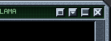
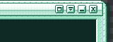

# Grimalkin

A GPU-accelerated terminal emulator written in Rust, aimed at Windows 10/11
(ConPTY) with the kitty graphics and keyboard protocols. It also builds and runs
on macOS and Linux, which is where it is mostly developed. Early software: the
core works, many conveniences are missing.

## What works today

- wgpu renderer with a glyph atlas, system font fallback (emoji, CJK, symbols),
  procedural box-drawing/block characters, wide chars and combining marks
- Terminal emulation: main/alt screen, scrollback (main screen), scroll regions,
  256/truecolor, underline styles and colors, mouse reporting (SGR), focus
  events, bracketed paste, synchronized output, OSC 0/2/4/7/8/10/11/12/52/133
- Kitty graphics protocol: direct/file/temp-file transmission, PNG and raw
  RGB(A), zlib, chunking, placement, source rects, z-index (above/below text),
  deletion, queries, images scrolling with text
- Kitty keyboard protocol (flag stack, query, key encoding)
- Selection, clipboard copy/paste, clickable OSC 8 hyperlinks, visual bell
  (optional audible), cursor shapes/blink, runtime zoom
- Themes (TOML or kitty `.conf`) with live config reload; TOML config: fonts, colors, window size/padding/opacity/title, cursor, bell, OSC 52
- Skins: undecorated, non-rectangular WinAMP-style windows (`--skin llama|grimalkin|mint`, or your own; see docs/SKINS.md)

Not done: no tabs or splits, no ligatures, no IME, no `U=1` unicode
placeholders, no animation frames (`a=f`).

## Installing on Windows

### Which download do I need?

Releases have one installer and one portable zip per CPU architecture:

| Your Windows | Download | Runs as |
| --- | --- | --- |
| Windows 10 or 11, Intel/AMD 64-bit (x64) | `grimalkin-setup-x64.exe` or `grimalkin-portable-x64.zip` | native x64 |
| Windows 11 on ARM64 (Snapdragon X, Windows Dev Kit, Parallels/VMware on Apple Silicon, ...) | `grimalkin-setup-arm64.exe` or `grimalkin-portable-arm64.zip` | native ARM64 (recommended) |
| Windows 11 on ARM64, x64 build | `grimalkin-setup-x64.exe` | x64 emulation (the fallback; may be slower) |
| Windows 10 on ARM64 | none | not supported (Windows 10 ARM64 has no x64 emulation, and the native build is only validated on Windows 11) |
| 32-bit x86 Windows | none | not supported |

If unsure: Settings, System, About, "System type" says `x64-based processor` or
`ARM-based processor`. The two builds have the same features. The x64 build keeps its
Windows 10 1809 minimum; the ARM64 minimum is Windows 11 until validated
otherwise. Each build bundles the ConPTY (`conpty.dll` and `OpenConsole.exe`)
of its own architecture.

> **ARM64 status:** the ARM64 build is compiled, packaged and install-tested on
> a native Windows 11 ARM64 CI runner, and the library test suite runs there.
> Interactive validation on real ARM64 hardware (GPU rendering, Preferences,
> DPI changes, clipboard, skins, kitty graphics and keyboard through the bundled
> ConPTY) is still in progress, tracked in
> [issue #1](https://github.com/rlankenau/grimalkin/issues/1). Report anything
> odd there; the x64 build under emulation is the known-good fallback.

### Installing

Download the installer for your machine from the
[Releases](https://github.com/rlankenau/grimalkin/releases) page and run it. It
installs per user by default (into `%LOCALAPPDATA%\Programs\grimalkin`, no
administrator prompt); the first page offers "install for all users" if you
want Program Files instead. The installer:

- installs `grimalkin.exe` and `grimalkin.com` (the console launcher, see
  [Windows: two files](#windows-two-files)) together, plus Microsoft's ConPTY
  redistributable (`conpty.dll` and `OpenConsole.exe`) beside them. The bundled
  ConPTY is what makes the kitty graphics protocol work on Windows 10 (see
  [Windows: kitty graphics need a newer ConPTY](#windows-kitty-graphics-need-a-newer-conpty));
  nothing extra to download
- adds a Start Menu shortcut, and optionally a desktop icon
- optionally adds grimalkin to your `PATH` so `grimalkin` works from any shell
- optionally adds an "Open grimalkin here" entry to Explorer's folder and
  folder-background right-click menus (it runs
  `grimalkin.exe --working-directory "<folder>"`)
- can launch grimalkin when it finishes
- upgrades in place: run a newer installer over an old one (a running grimalkin
  is closed first); uninstall from Settings, Apps, which also removes the PATH
  entry and context-menu keys. Your config in `%APPDATA%\grimalkin` is kept

Silent install, for scripts: `grimalkin-setup-<arch>.exe /VERYSILENT /TASKS="addtopath,contextmenu"`
(add `/ALLUSERS` for a machine-wide install).

Prefer no installer? `grimalkin-portable-<arch>.zip` has the same files
(including the ConPTY pair); unzip it anywhere and run `grimalkin.exe`.

**Switching between x64 and ARM64 (for example from an emulated x64 install to
the native ARM64 build).** Both architectures share one installer identity,
install folder, `PATH` entry and context-menu keys, so only one can be installed
at a time and the installer enforces that. Run the new installer: it finds the
other-architecture install (per-user or all-users) and offers to uninstall it
first (Yes continues, No cancels without changing anything). That uninstall
removes the old files, `PATH` entry and context-menu keys; the new installer
then installs the new ones, so tick the same optional tasks again. Your config
and skins in `%APPDATA%\grimalkin` are kept. For scripted installs, the
installer refuses to replace an install of the other architecture unless you
pass `/REPLACEARCH=1` (exit code 1 otherwise). Installs made before ARM64
existed are x64 by definition. Portable zips never interfere with the installer
or each other; keep them in different folders. To go back, run the x64
installer the same way.

**Releases.** Pushing a tag matching `v*` (for example `v0.2.0`) runs CI, which
publishes everything to the GitHub release: per architecture the installer
(`grimalkin-setup-x64.exe`, `grimalkin-setup-arm64.exe`, versioned from the tag)
and the portable zip (`grimalkin-portable-x64.zip`,
`grimalkin-portable-arm64.zip`). The bare `grimalkin.exe` / `grimalkin.com` are
no longer separate release assets (the names would collide between
architectures); they are inside the zips, and available per architecture as the
`grimalkin-windows-x64` / `grimalkin-windows-arm64` workflow artifacts on every
trunk build, together with the installers and zips. x64 is built on
`windows-latest`, ARM64 natively on the `windows-11-arm` runner (target
`aarch64-pc-windows-msvc`), where the tests and the installer smoke test also
run. The installers are built from `installer/windows/grimalkin.iss`
(`/DArch=x64|arm64`) with Inno Setup 6.3 or newer; the ConPTY package version
and SHA256 are pinned in `.github/workflows/ci.yml`, which packages the
architecture-matching DLL/OpenConsole pair, fails if it is missing, and checks
the PE machine type of every shipped binary
(`scripts/windows/check-pe-machine.ps1`).

## Requirements

- Rust stable 1.92+
- Windows: just `cargo`
- macOS: just `cargo`
- Linux: `sudo apt-get install libxkbcommon-dev libwayland-dev libfontconfig1-dev`

## Build and run

```
cargo run --release -p grimalkin
cargo run --release -p grimalkin -- [OPTIONS] [-e COMMAND [ARGS...]]
```

| Flag | Meaning |
| --- | --- |
| `-e`, `--command CMD [ARGS...]` | Run CMD instead of the shell (consumes the remaining arguments) |
| `--config PATH` | Use this config file |
| `--working-directory DIR` | Start in DIR |
| `--skin NAME` | Use a window skin (llama, grimalkin, mint, or a path; `none` = normal window) |
| `--theme NAME` | Use this color theme (overrides `theme` in the config) |
| `--list-themes` | List built-in and user themes, then exit |
| `--list-skins` | List built-in skins and installed WinAMP skins, then exit |
| `--install-skin PATH_OR_URL` | Install a WinAMP `.wsz` (local file or https URL) and exit; `--force` overwrites |
| `-h`, `--help` / `-V`, `--version` | Help / version |

The release binary is `target/release/grimalkin`.

### Windows: two files

The Windows release is two files that belong in the same folder:

- `grimalkin.exe` is the GUI-subsystem terminal. Double-click it (or a
  shortcut to it) to open a window; no console window appears.
- `grimalkin.com` is a tiny console-subsystem launcher (built from
  `crates/launcher` as `grimalkin-launcher.exe` and renamed). cmd and
  PowerShell resolve a bare `grimalkin` to the `.com` before the `.exe`, so
  from a shell `grimalkin ...` runs the launcher, which starts `grimalkin.exe`
  from its own folder with the identical command line, waits for it and exits
  with its exit code. Output (`--help`, `--list-themes`, `--list-skins`,
  `--install-skin`, errors) therefore prints before the next prompt, and
  `$LASTEXITCODE` / `%ERRORLEVEL%` are set. The old workarounds
  (`grimalkin --list-skins | Out-Host`, `start /wait grimalkin ...`) are no
  longer needed with the `.com` present. Ctrl+C is left to the child.

Without `grimalkin.com`, `grimalkin.exe` still attaches to the parent console
to print, but the shell does not wait for it (the prompt redraws over the
output and exit codes are not set).

The optional `conpty.dll` and `OpenConsole.exe` (newer ConPTY) go in this same
folder, next to both files, as before.

When building yourself: `cargo build --release -p grimalkin -p grimalkin-launcher`,
then copy `target/release/grimalkin-launcher.exe` to `grimalkin.com` beside
`grimalkin.exe`.

## Installing on macOS

Download `grimalkin-<version>-macos-arm64.dmg` (Apple Silicon) or
`grimalkin-<version>-macos-x86_64.dmg` (Intel) from the latest release or the
CI artifacts, open it and drag `grimalkin.app` onto the Applications shortcut.

Release builds are signed with a Developer ID and notarized by Apple, so the
app opens normally with no Gatekeeper warning.

A build you make from source (or a CI artifact from a fork or pull request,
which has no signing secrets) is only ad-hoc signed and not notarized, so
Gatekeeper blocks the first launch. Either right-click the app in
Applications, choose Open, then Open again in the dialog (once is enough), or
clear the quarantine flag from a terminal:

```
xattr -d com.apple.quarantine /Applications/grimalkin.app
```

When started from Finder the shell opens in your home directory. To build the
app and dmg yourself run `scripts/make-app-bundle.sh` (output in `dist/`;
options `--target`, `--binary`, `--no-dmg`, `--no-notarize`; `--help` lists the
signing variables). It signs with the first "Developer ID Application"
identity in your keychain (or `GRIMALKIN_SIGN_IDENTITY`; `-` forces ad-hoc) and,
if `GRIMALKIN_NOTARY_PROFILE` names a `notarytool` keychain profile, notarizes
and staples both the app and the dmg:

```
xcrun notarytool store-credentials grimalkin --apple-id you@example.com \
    --team-id TEAMID --password <app-specific-password>
GRIMALKIN_NOTARY_PROFILE=grimalkin scripts/make-app-bundle.sh
```

### Release signing setup

The `macos bundle` CI job signs and notarizes when these repository secrets
exist (Settings > Secrets and variables > Actions). With any of them missing it
builds ad-hoc signed as before.

| Secret | What it is |
| --- | --- |
| `MACOS_CERT_P12_BASE64` | Developer ID Application certificate and private key as base64 `.p12`. In Keychain Access export it (File > Export Items, format .p12), then `base64 -i cert.p12 \| pbcopy`. |
| `MACOS_CERT_PASSWORD` | The password you chose when exporting the `.p12`. |
| `NOTARY_KEY_P8_BASE64` | App Store Connect API key (Users and Access > Integrations > App Store Connect API, a team key), the downloaded `AuthKey_XXXX.p8` as base64: `base64 -i AuthKey_XXXX.p8 \| pbcopy`. |
| `NOTARY_KEY_ID` | That key's Key ID. |
| `NOTARY_ISSUER_ID` | The Issuer ID shown above the key list. |

The certificate secrets alone give a signed (not notarized) build; notarization
needs all three `NOTARY_*` secrets.

## Configuration

Every key is optional. Default location:

- Windows: `%APPDATA%\grimalkin\grimalkin.toml`
- macOS/Linux: `$XDG_CONFIG_HOME/grimalkin/grimalkin.toml`, else
  `~/.config/grimalkin/grimalkin.toml`

A missing file is fine. The full commented list is in
[docs/grimalkin.example.toml](docs/grimalkin.example.toml).

```toml
scrollback_lines = 10000

[font]
family = ["JetBrains Mono", "Consolas"]
size = 13.0

[window]
cols = 120
rows = 35
opacity = 0.95
title = "grimalkin"      # shown until the shell sets one
dynamic_title = true     # false: ignore OSC 0/2 titles

theme = "catppuccin-mocha"

[colors]            # per-key overrides on top of the theme
background = "#101014"

[cursor]
shape = "bar"
blink = true

[input]
option_as_alt = true   # macOS
ctrl_v_paste = true    # plain Ctrl+V pastes via grimalkin (default on Windows)
```

## Skins & themes

Two independent layers, like the media players of the late 90s: a **theme**
recolours the terminal, a **skin** replaces the window frame with bitmap
artwork, including non-rectangular shapes (WinAMP style).

| llama | grimalkin | mint |
|:-:|:-:|:-:|
|  |  |  |

```toml
skin  = "llama"        # llama | grimalkin | mint | a folder of your own | "none"
theme = "dracula"
```

`grimalkin --skin grimalkin --theme nord` does the same from the command line.
A skinned window has no OS title bar: drag the title bar or the frame to move,
the edges and the corner grip to resize, double-click the title bar for the
skin's action (usually *windowshade*: the window collapses to its title bar
and restores on the next double-click or shade button). Pixels outside the
artwork's shape are transparent and click through.

A skin is a folder with `skin.toml`, `frame.png` (9-slice), `buttons.png` and
optionally `shade.png` and `frame@2x.png`; put yours in
`<config dir>/grimalkin/skins/NAME/`. The format is documented in
[docs/SKINS.md](docs/SKINS.md), and `scripts/gen-skins.py` shows how the
built-in skins are drawn. On a skinned window the grid starts at the skin's
viewport inset plus `[window] padding`; the skin's `viewport_background` is the
terminal background unless you chose a theme or `[colors] background`.

### WinAMP skins

Classic WinAMP 2.x skins (`.wsz`) work as window frames. Grimalkin uses the
artwork of the **playlist editor** window (`pledit.bmp`), the one WinAMP window
that resizes, so the terminal sits inside a real WinAMP playlist frame (title
art, close and windowshade buttons, the bottom bar), and `pledit.txt` supplies
the colors. Browse thousands of skins at the
[Skin Museum](https://skins.webamp.org), then:

```sh
grimalkin --install-skin https://skins.webamp.org/skin/<md5>/     # a museum page, a direct .wsz URL or a local file
grimalkin --list-skins
```

and put the name it prints in `grimalkin.toml`:

```toml
skin = "winamp:base-2.91"          # <config dir>/grimalkin/skins/base-2.91.wsz
# skin = "C:/skins/Cool.wsz"       # a path to a .wsz, or to an unpacked folder with pledit.bmp, also works
# winamp_viscolor_palette = true   # optionally take the 16 ANSI colors from the skin's viscolor.txt
```

While a WinAMP skin is active its `pledit.txt` colors (text, list background,
selection, current-track color) become the theme, unless you set `theme =` (or
`--theme`) yourself; `[colors]` overrides still apply on top. A `Font=` hint is
used only if that font is installed *and* monospaced. Skins are read from the
archive on every launch and never extracted to disk. Details and deviations
from the original spec: [docs/WINAMP_SKINS.md](docs/WINAMP_SKINS.md).

### Themes and live reload

`theme = "NAME"` (or `--theme NAME`) selects a color theme: colors, optional
cursor and font settings. Built in: `default`, `catppuccin-mocha`, `dracula`,
`gruvbox-dark`, `solarized-light`, `nord`, `tokyo-night`. `grimalkin --list-themes`
lists them along with your own.

Your own themes go in `<config dir>/grimalkin/themes/` (the directory that holds
`grimalkin.toml`):

- `NAME.toml`: grimalkin format, a `name`, a `[colors]` table (`foreground`,
  `background`, `cursor`, `cursor_text`, `selection_background`,
  `selection_foreground`, `url`, `black` .. `bright_white` or `color0` ..
  `color15`) and optional `[font]` / `[cursor]` tables.
- `NAME.conf`: a kitty theme file. Drop in anything from
  [kitty-themes](https://github.com/kovidgoyal/kitty-themes).

The `[colors]` table of `grimalkin.toml` overrides the theme key by key.

The config directory (config file, `themes/`, `skins/`) is watched. Saving a
file re-applies the theme, colors, cursor, font and, between two skins, the
window skin in the running window, with no restart (switching between a skin
and a normal window needs a restart). A file with a syntax error is reported
in the log and the running settings are kept. (`--theme` and `--skin` keep
winning over the file.)

## Menus

macOS has a menu bar: Settings... (Cmd+,) and Quit (Cmd+Q) in the app menu, Edit (Copy, Paste), View (zoom,
and Themes / Skins submenus that switch live by editing `grimalkin.toml` in
place, keeping its comments), Window and Help (open the config file, reveal
the themes folder). On macOS and Windows, right-click opens the same items as a
context menu (when the program is not using the mouse; Shift+right-click
always). Windows keeps the skinned window chrome-free, so it has no menu bar.
Linux has no menus yet.

## Preferences

Settings... (Cmd+, on macOS; Ctrl+, elsewhere; also in the right-click menu)
opens a Preferences window with Appearance (theme with palette previews, skin,
opacity, padding), Font (family, installed monospace fonts, size, line height),
Cursor, Terminal (scrollback, shell, title, bell), and Advanced (graphics
cursor, clipboard, install a WinAMP skin from a file or URL, open the config
file and the themes/skins folders). Every control writes `grimalkin.toml`
straight away, keeping your comments, and the running terminal applies it live
(slider drags are written ten times a second at most). "Reset ... to defaults"
removes that section's keys from the file. Escape or Cmd/Ctrl+W closes the
window. The window is drawn with egui on its own GPU device (egui-wgpu 0.35
needs wgpu 29; the terminal uses wgpu 30). Shell, graphics cursor and the
Windows ConPTY mode only apply to a new launch, and so does switching
between a plain window and a skin (the window says so when you try; switching
between two skins is live).

## Key bindings

"Mod" is Ctrl+Shift on Windows/Linux, and Cmd (or Ctrl+Shift) on macOS.

| Keys | Action |
| --- | --- |
| Mod+C | Copy selection |
| Mod+V, Shift+Insert | Paste |
| Ctrl+V (Windows; `input.ctrl_v_paste`, default on) | Paste, sanitised, instead of sending Ctrl+V to the shell |
| Mod++ / Mod+- | Zoom in / out |
| Mod+0 | Reset zoom |
| Cmd+, (macOS) / Ctrl+, | Preferences |
| Shift+PageUp / Shift+PageDown | Scroll a page (main screen) |
| Mouse wheel | Scroll scrollback (or sent to the app in mouse mode) |

## Testing kitty graphics

The `gcat` example is a small cross-platform `icat` (works on Windows):

```
cargo run -p grimalkin-graphics --example gcat -- --demo
cargo run -p grimalkin-graphics --example gcat -- picture.png
cargo run -p grimalkin-graphics --example gcat -- --place 40x12@5x3 --z -1 picture.png
cargo run -p grimalkin-graphics --example gcat -- --delete
```

Other options: `--zlib`, `--png`, `--no-move`, `--id N`, `--no-query`.

On macOS, with kitty's `kitten` installed, `scripts/icat-test.sh [case...]`
drives `kitten icat` through several scenarios (basic, place, alpha, big,
scroll, clear, zindex, altscreen) and captures frames. `MODE=dump` (default) is
offscreen; `MODE=screen` captures the real window. `scripts/kitty-send.py` is a
raw protocol sender.

Startup font loading: the first run scans all system fonts and writes an index
(`fonts.cache` under the user cache dir, e.g. `%LOCALAPPDATA%\\grimalkin` on Windows). Later runs
load only the configured families from the index and build the full set (emoji/CJK
fallback) on a background thread. Set `GRIMALKIN_EXIT_AFTER_FRAME=1` to quit after the
first frame (for timing).

Set `GRIMALKIN_DUMP_FRAME=/path/frame.png` to render offscreen and write each
frame to that PNG (useful over ssh or with a locked screen).

## TERM

Children get `TERM=xterm-kitty` so kitty-aware tools enable graphics and
keyboard protocols. On Unix, if no kitty terminfo database can be found
(`TERMINFO` is pointed at kitty's bundled one when present), Grimalkin falls
back to `TERM=xterm-256color` so vim, tmux, less and friends keep working. See
`crates/gui/src/terminfo.rs`.

## Windows: kitty graphics need a newer ConPTY

Stock Windows 10 ConPTY (conhost 10.0.19041) strips APC sequences
(`ESC _ ... ESC \`), so the kitty graphics protocol never reaches Grimalkin, and
it swallows the kitty keyboard query (`CSI ? u`). Grimalkin talks to ConPTY
directly (`crates/pty/src/win/`) and can use Microsoft's current one:

1. Download the `Microsoft.Windows.Console.ConPTY` NuGet package (a `.nupkg` is
   a zip file) and take `runtimes/win-x64/native/conpty.dll` and
   `build/native/runtimes/x64/OpenConsole.exe` (paths vary a little by
   package version; use the x64 pair).
2. Put both files in the same directory as `grimalkin.exe`.

At startup Grimalkin loads `conpty.dll` from the executable's directory if it
exists and falls back to the in-box `kernel32.dll` ConPTY otherwise. Run with
`RUST_LOG=info` to see which one was used.

For the best chance of APC and other sequences arriving untouched, also turn on
passthrough mode (`PSEUDOCONSOLE_PASSTHROUGH_MODE`), which stops ConPTY from
re-rendering the child's output:

```toml
[pty]
passthrough = true
```

or set `GRIMALKIN_CONPTY_PASSTHROUGH=1` (`0` forces it off), which overrides
the file. Passthrough only applies to the in-box ConPTY of Windows 11 24H2 or newer;
if it rejects the flag, Grimalkin logs a warning and starts without it. It is
never sent to a sideloaded `conpty.dll` (see below).
Passthrough is off by default.

Tested facts (Windows 10, ConPTY package 1.25):

- Stock Windows 10 ConPTY strips APC, so kitty graphics do not work at all.
- Sideloading `Microsoft.Windows.Console.ConPTY` 1.25 (`conpty.dll` +
  `OpenConsole.exe` next to `grimalkin.exe`) makes kitty graphics work.
- In the redistributable ConPTY (1.24+), bit 0x8 is not passthrough: it is
  `PSEUDOCONSOLE_GLYPH_WIDTH_GRAPHEMES` (the glyph-width mask is 0x18:
  GRAPHEMES 0x08, WCSWIDTH 0x10, CONSOLE 0x18; `AMBIGUOUS_IS_WIDE` is 0x20),
  and 0x2/0x4 are unused. That is why a passthrough flag appeared to do
  nothing there. Grimalkin therefore sets 0x8 only for the in-box ConPTY; the
  sideloaded one already forwards unknown sequences.
- The APC *reply* to a query (`a=q`) is stripped on the input side, so tools
  must detect support through `TERM_PROGRAM=grimalkin` / `TERM=xterm-kitty`
  rather than by querying.
- Cursor position reports (CPR) are swallowed.
- OpenConsole does not learn that a placement moved the cursor, so Grimalkin
  does not move it after placements on Windows (`[pty] graphics_cursor = "auto"`;
  set `"protocol"` to override). Tools then print their own newlines, e.g.
  `gcat --conpty`.
- `viu`'s kitty auto-detection hangs on Windows in any terminal (a bug in
  viuer's input parsing); `viu -b` (block mode) works.

## App icon

The pixel-art cat lives in `assets/icon/`: `grimalkin-<size>.png` (16 to 1024),
`grimalkin.ico` (16 to 256, PNG entries, Windows Vista+) and `grimalkin.icns`
(macOS, for the `.app` bundle). They are generated, byte-for-byte reproducibly,
by `python3 scripts/gen-icon.py` (pure Python; the `.icns` step needs macOS
`iconutil`, pass `--no-icns` to skip it).

On Windows, `crates/gui/build.rs` and `crates/launcher/build.rs` embed the `.ico`
plus version info (ProductName, FileVersion from the crate version, ...) into
`grimalkin.exe` and `grimalkin.com` through the `winresource` crate (needs
`rc.exe`, which the MSVC toolchain provides); CI checks the result. On Windows
and Linux the window icon is also set at runtime from the 64 px PNG
(`crates/gui/src/icon.rs`).

## Crate layout

- `crates/vt` (`grimalkin-vt`): terminal state machine, no I/O or GUI
- `crates/graphics` (`grimalkin-graphics`): kitty graphics protocol, image
  store, `gcat` example
- `crates/pty` (`grimalkin-pty`): PTY layer: native ConPTY on Windows, portable-pty (forkpty) on Unix
- `crates/gui` (`grimalkin`): the binary: winit + wgpu renderer, input, config

See [ARCHITECTURE.md](ARCHITECTURE.md) for details. Tests: `cargo test --workspace`.

## License

MIT OR Apache-2.0: see [LICENSE](LICENSE), [LICENSE-MIT](LICENSE-MIT) and
[LICENSE-APACHE](LICENSE-APACHE). The bundled ConPTY redistributable is MIT
licensed by Microsoft: see
[installer/windows/LICENSE-ConPTY.txt](installer/windows/LICENSE-ConPTY.txt).
